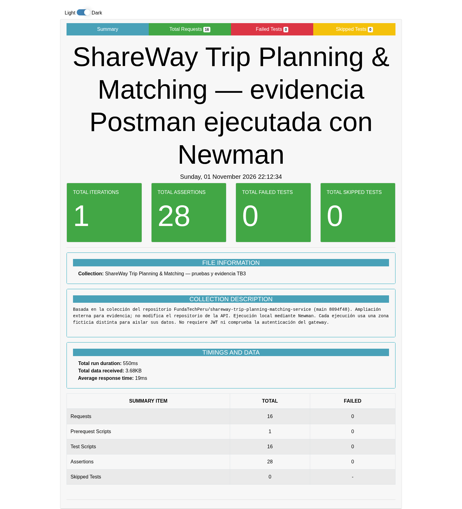

# Pruebas de Trip Planning & Matching — colección Postman

**Resultado:** 16 solicitudes y 28 aserciones, sin fallos.

Ejecución local del 1 de noviembre de 2026 sobre `shareway-trip-planning-matching-service`, commit `8094f48d18ab37fe70258e78a2b6e6ccbb838cc0`.

La colección se ejecutó con Newman 6.2.3, ejecutor de colecciones Postman. Las 17 capturas son del reporte generado por `newman-reporter-htmlextra`, no de la interfaz gráfica de Postman. No se modificó el código de la API. No se escribieron datos en Render ni se usaron otras APIs.

## Archivos

- `ShareWay-Trip-Planning-TB3.postman_collection.json`: colección importable en Postman, con 16 solicitudes y aserciones.
- `reporte-newman-offline.html`: reporte de resultados con dependencias locales en `assets/`. Abrir después de descargar y descomprimir el ZIP.
- `reporte-newman.html`: reporte original del ejecutor con dependencias CDN.
- `resultados-newman.json`: solicitudes, respuestas y aserciones completas de la ejecución.
- `ejecucion-newman.log`: salida del ejecutor.
- `capturas/`: resumen y evidencia de las 16 solicitudes.

## Casos y capturas

| Caso | Método y ruta | HTTP observado | Captura |
|---|---|---|---|
| 01 Salud del servicio | `GET /actuator/health` | 200 | [Ver](capturas/01-solicitud-newman.png) |
| 02 Registrar disponibilidad compatible | `POST /api/v1/driver-availabilities` | 201 | [Ver](capturas/02-solicitud-newman.png) |
| 03 Crear solicitud de viaje | `POST /api/v1/trip-requests` | 201 | [Ver](capturas/03-solicitud-newman.png) |
| 04 Consultar solicitudes | `GET /api/v1/trip-requests` | 200 | [Ver](capturas/04-solicitud-newman.png) |
| 05 Generar propuestas compatibles | `POST /api/v1/trip-requests/17f0cfa0-c154-41f0-9d76-48056dcbeb31/match-proposals` | 200 | [Ver](capturas/05-solicitud-newman.png) |
| 06 Repetir generación sin duplicados | `POST /api/v1/trip-requests/17f0cfa0-c154-41f0-9d76-48056dcbeb31/match-proposals` | 200 | [Ver](capturas/06-solicitud-newman.png) |
| 07 Consultar propuestas guardadas | `GET /api/v1/trip-requests/17f0cfa0-c154-41f0-9d76-48056dcbeb31/match-proposals` | 200 | [Ver](capturas/07-solicitud-newman.png) |
| 08 Rechazar solicitud vacía | `POST /api/v1/trip-requests` | 400 | [Ver](capturas/08-solicitud-newman.png) |
| 09 Rechazar latitud fuera de rango | `POST /api/v1/trip-requests` | 400 | [Ver](capturas/09-solicitud-newman.png) |
| 10 Rechazar disponibilidad sin asientos | `POST /api/v1/driver-availabilities` | 400 | [Ver](capturas/10-solicitud-newman.png) |
| 11 Solicitud inexistente al generar matching | `POST /api/v1/trip-requests/00000000-0000-0000-0000-000000000000/match-proposals` | 404 | [Ver](capturas/11-solicitud-newman.png) |
| 12 Rechazar UUID mal formado | `POST /api/v1/trip-requests/no-es-un-uuid/match-proposals` | 400 | [Ver](capturas/12-solicitud-newman.png) |
| 13 Crear solicitud sin conductores en la zona | `POST /api/v1/trip-requests` | 201 | [Ver](capturas/13-solicitud-newman.png) |
| 14 Matching sin conductores compatibles | `POST /api/v1/trip-requests/316ed3a3-9d4d-43ea-886d-50cb490e763f/match-proposals` | 200 | [Ver](capturas/14-solicitud-newman.png) |
| 15 Crear solicitud de cuatro asientos | `POST /api/v1/trip-requests` | 201 | [Ver](capturas/15-solicitud-newman.png) |
| 16 Matching descarta cupos insuficientes | `POST /api/v1/trip-requests/14f9e862-dea6-4928-8d8f-3326ec957244/match-proposals` | 200 | [Ver](capturas/16-solicitud-newman.png) |



## Repetir en Postman

1. Iniciar la API local y PostgreSQL. En esta instancia se utilizó `currentSchema=shareway` para alinear Hibernate con las migraciones de Flyway.
2. Importar `ShareWay-Trip-Planning-TB3.postman_collection.json`.
3. Mantener `baseUrl=http://localhost:8081` o ajustarlo a otra instancia local de prueba. No requiere `JWT_SECRET` ni autorización Bearer en esta versión.
4. Ejecutar las 16 solicitudes en orden desde Collection Runner. Las variables de UUID y zona se completan automáticamente.

Cada ejecución crea una zona ficticia diferente y registra datos de prueba en la base local. La consulta general de solicitudes puede incluir datos de otras ejecuciones locales; la aserción comprueba la presencia de la solicitud de la corrida actual.

## Repetir con Newman

```bash
npm install newman newman-reporter-htmlextra
npx newman run ShareWay-Trip-Planning-TB3.postman_collection.json --reporters cli,json,htmlextra --reporter-json-export resultados-newman.json --reporter-htmlextra-export reporte-newman.html
```

La cobertura comprende los cinco endpoints de negocio y el health check: disponibilidad, creación y consulta de solicitudes, generación y consulta de propuestas, repetición secuencial sin duplicados, errores de entrada y ausencia de candidatos por zona o asientos. No constituye una prueba de integración del gateway, seguridad JWT, concurrencia o rendimiento.